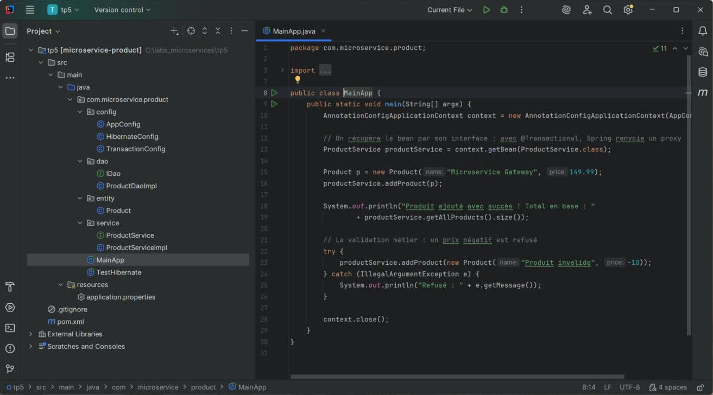
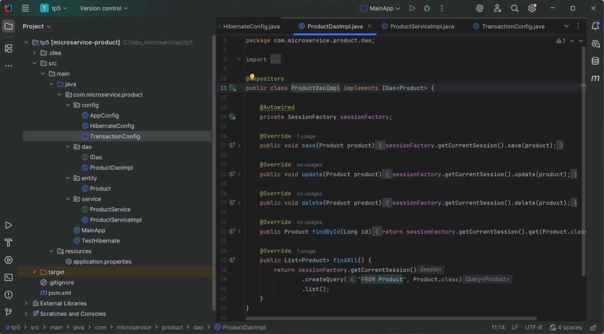
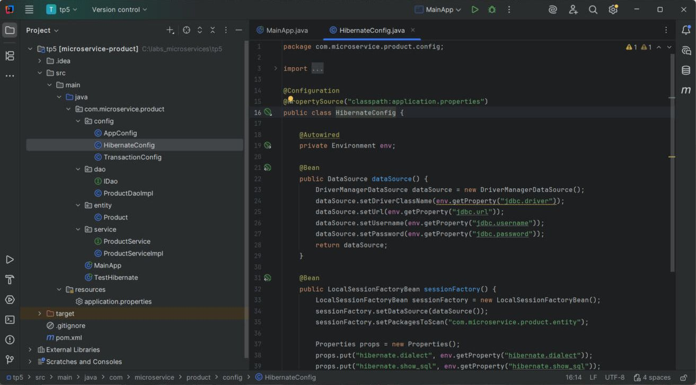
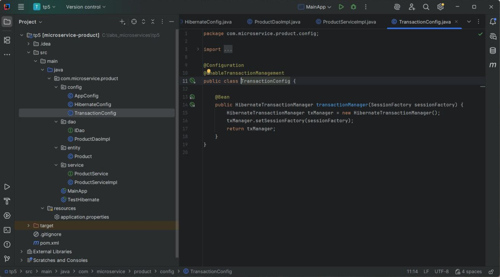
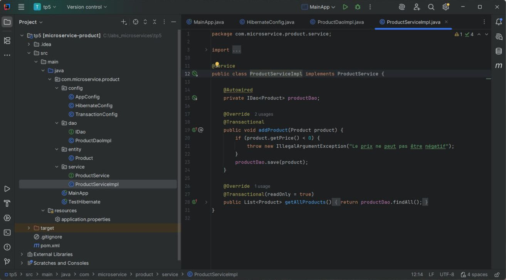

# TP 5 – Intégration de Spring et Hibernate dans une Architecture Microservices

> Module : **Architecture Microservices – Conception, Déploiement et Orchestration**

Ce TP construit le microservice **`microservice-product`** : un service qui gère des produits et les enregistre dans **MySQL**.
Par rapport au TP4, c'est **Spring** qui prend la main : il crée les objets (IoC), les relie entre eux (`@Autowired`), fournit la `SessionFactory` d'Hibernate et gère les transactions avec **`@Transactional`**.



---

## Sommaire

1. [Objectifs](#objectifs)
2. [Technologies](#technologies)
3. [Architecture du projet](#architecture-du-projet)
4. [Réalisation pas à pas](#réalisation-pas-à-pas)
5. [TP4 vs TP5 : ce que Spring change](#tp4-vs-tp5--ce-que-spring-change)
6. [Lancer le projet](#lancer-le-projet)
7. [Résumé du TP](#résumé-du-tp)

---

## Objectifs

- Gérer les dépendances Spring + Hibernate avec **Maven**.
- Configurer la **source de données** et la **SessionFactory** dans des classes Spring `@Configuration`.
- Mapper une entité avec **JPA/Hibernate**.
- Appliquer le **pattern DAO générique** `IDao<T>`.
- Utiliser l'**injection de dépendances** (`@Autowired`) et la **gestion déclarative des transactions** (`@Transactional`).

## Technologies

| Outil | Version | Rôle |
|-------|---------|------|
| Java | 17 | Langage |
| Maven | 3.x | Dépendances et build |
| Spring Context | 5.3.20 | Conteneur IoC, configuration Java |
| Spring ORM | 5.3.20 | Intégration Hibernate (`LocalSessionFactoryBean`, `HibernateTransactionManager`) |
| Hibernate Core | 5.6.9.Final | ORM (implémentation de JPA) |
| MySQL Connector/J | 8.0.33 | Pilote JDBC MySQL |

## Architecture du projet

```
tp5/
├── pom.xml
├── screenshots/
└── src/main
    ├── java/com/microservice/product
    │   ├── config
    │   │   ├── AppConfig.java           # @ComponentScan : active la détection des beans
    │   │   ├── HibernateConfig.java     # DataSource + LocalSessionFactoryBean
    │   │   └── TransactionConfig.java   # @EnableTransactionManagement + HibernateTransactionManager
    │   ├── dao
    │   │   ├── IDao.java                # interface DAO générique <T>
    │   │   └── ProductDaoImpl.java      # @Repository, utilise getCurrentSession()
    │   ├── entity
    │   │   └── Product.java             # @Entity -> table products
    │   ├── service
    │   │   ├── ProductService.java      # interface de la couche métier
    │   │   └── ProductServiceImpl.java  # @Service + @Transactional + validation du prix
    │   ├── TestHibernate.java           # vérifie que le contexte Spring démarre
    │   └── MainApp.java                 # scénario complet : ajout + lecture d'un produit
    └── resources
        └── application.properties      # paramètres JDBC et Hibernate
```

Le chemin d'un appel :

```
MainApp → ProductService (proxy @Transactional) → ProductDaoImpl → SessionFactory.getCurrentSession() → MySQL
```

Spring crée chaque objet une seule fois (un **bean**), puis l'injecte là où il est demandé avec `@Autowired`.

---

## Réalisation pas à pas

### 1. Projet Maven `microservice-product`

`pom.xml` déclare `spring-context`, `spring-orm` et `hibernate-core`. Les versions sont centralisées dans `<properties>`.

> **Correction apportée :** l'énoncé ne contient pas le pilote MySQL. Sans lui, aucune connexion n'est possible : `mysql-connector-java` a donc été ajouté.

### 2. Configuration de la base (`application.properties`)

Les paramètres de connexion (`jdbc.*`) et d'Hibernate (`hibernate.*`) sont externalisés dans un fichier de propriétés. On peut ainsi changer d'environnement (dev, test, prod) sans modifier le code, ce qui est essentiel en microservices.

### 3. Entité `Product`

`@Entity` + `@Table(name = "products")`, une clé `Long id` auto-incrémentée (`IDENTITY`), et `@Column(nullable = false)` sur `name` et `price`.

### 4. Interface DAO générique `IDao<T>`

`save`, `update`, `delete`, `findById(Long)`, `findAll()`. Le paramètre de type `<T>` garantit la sécurité des types à la compilation et évite de dupliquer le CRUD pour chaque entité.

### 5. `ProductDaoImpl`

- `@Repository` : Spring détecte la classe et en fait un bean (avec traduction des exceptions de persistance).
- `@Autowired SessionFactory` : la SessionFactory est **injectée par Spring** (plus de `HibernateUtil`).
- `getCurrentSession()` : récupère la session **liée à la transaction en cours**, ouverte et fermée par Spring. Il n'y a plus ni `openSession()`, ni `beginTransaction()`, ni `commit()` dans le DAO.



### 6. `HibernateConfig`

- `@Configuration` + `@PropertySource("classpath:application.properties")` ; `Environment` lit les propriétés.
- Bean **`DataSource`** (`DriverManagerDataSource`) : URL, utilisateur, mot de passe.
- Bean **`LocalSessionFactoryBean`** : construit la `SessionFactory` à partir de la DataSource. `setPackagesToScan` trouve les entités, ce qui remplace `<mapping class>` du TP4.



### 7. Transactions avec Spring (`TransactionConfig`)

- `@EnableTransactionManagement` active la prise en compte de `@Transactional`.
- Bean **`HibernateTransactionManager`** relié à la `SessionFactory`.

> **Correction apportée :** l'import `org.SessionFactory` de l'énoncé est faux. Le bon import est `org.hibernate.SessionFactory`.



### 8. Couche Service

- Interface `ProductService` + implémentation `ProductServiceImpl` annotée `@Service`.
- `@Transactional` sur `addProduct` : Spring ouvre la transaction avant la méthode, fait un **commit** à la fin, ou un **rollback** si une `RuntimeException` est levée.
- **Règle métier** : un prix négatif lève `IllegalArgumentException`, et rien n'est enregistré.
- `@Transactional(readOnly = true)` sur la lecture : une optimisation pour les requêtes qui ne modifient rien.



### 9. Contexte Spring (`AppConfig`)

`@ComponentScan(basePackages = "com.microservice.product")` détecte automatiquement les classes `@Repository`, `@Service` et `@Configuration`.

### 10. Vérification (`TestHibernate`)

Démarre `AnnotationConfigApplicationContext(AppConfig.class)`, affiche « Contexte Spring initialisé avec succès ! » et vérifie que la `SessionFactory` est bien créée.

### 11. Scénario complet (`MainApp`)

Ajoute le produit **« Microservice Gateway » à 149,99**, affiche le nombre total de produits, puis essaie d'ajouter un produit à **-10** : la validation métier le refuse.

> **Choix technique :** le service est récupéré par son **interface** (`context.getBean(ProductService.class)`). Avec `@Transactional`, Spring ne renvoie pas l'objet lui-même mais un **proxy** qui implémente l'interface. Demander `ProductServiceImpl.class` provoquerait une erreur `NoSuchBeanDefinitionException`.

---

## TP4 vs TP5 : ce que Spring change

| Aspect | TP4 (Hibernate seul) | TP5 (Spring + Hibernate) |
|--------|----------------------|--------------------------|
| Configuration | `hibernate.cfg.xml` | Classes `@Configuration` + `application.properties` |
| SessionFactory | Créée à la main dans `HibernateUtil` | Bean `LocalSessionFactoryBean` créé par Spring |
| Mapping des entités | `<mapping class="…"/>` | `setPackagesToScan(...)` |
| Création des objets | `new SalleDao()` | Beans détectés par `@ComponentScan`, injectés par `@Autowired` |
| Session | `openSession()` + try-with-resources | `getCurrentSession()` (gérée par Spring) |
| Transactions | `beginTransaction()` / `commit()` / `rollback()` codés à la main | **`@Transactional`** (déclaratif) |

## Lancer le projet

1. Démarrer **MySQL** sur `localhost:3306`.
2. Vérifier `jdbc.username` / `jdbc.password` dans `src/main/resources/application.properties` (`root` / `secret` dans l'énoncé). La base `product_db` est créée automatiquement.
3. Ouvrir le dossier dans IntelliJ (projet Maven), puis exécuter **`TestHibernate`**, puis **`MainApp`**.

Sortie attendue de `MainApp` :

```
Hibernate: insert into products (name, price) values (?, ?)
Hibernate: select ... from products ...
Produit ajouté avec succès ! Total en base : 1
Refusé : Le prix ne peut pas être négatif
```

---

## Résumé du TP

Ce TP a transformé la persistance « manuelle » du TP4 en un vrai microservice **Spring + Hibernate** :

- **Maven** gère les dépendances Spring, Hibernate et le pilote MySQL.
- **Configuration en Java** (`@Configuration`, `@Bean`, `@PropertySource`) : la `DataSource` et la `SessionFactory` deviennent des beans Spring, et les paramètres sont externalisés.
- **Entité JPA** `Product`, mappée sur la table `products`.
- **DAO générique** `IDao<T>` + `ProductDaoImpl` (`@Repository`), qui utilise `getCurrentSession()`.
- **Injection de dépendances** : `@ComponentScan` détecte les beans, `@Autowired` les relie.
- **Transactions déclaratives** : `@EnableTransactionManagement` + `HibernateTransactionManager` + `@Transactional`. Commit et rollback deviennent automatiques.
- **Logique métier** dans la couche Service (refus d'un prix négatif).

**Prochaines étapes** : exposer le service en REST (Spring MVC / `@RestController`), puis l'enregistrer dans un annuaire de services (Eureka).
